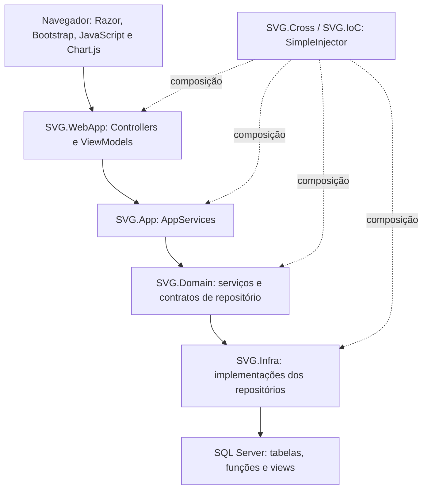

# SVG.DOE — contexto, arquitetura e regras identificadas

Levantamento em 20/10/2026, por leitura estática do código local, mensagens acessíveis do projeto ChatGPT SVG.DOE e texto das apresentações locais. Referência inicial do Git: `927336e` (`Ajustando`).

## Alcance e limites

Este documento registra o entendimento obtido, não certifica que todo o histórico foi recuperado nem que todos os fluxos foram testados.

- A integração retornou cinco conversas do projeto entre as 50 conversas recentes disponíveis. Não oferece paginação nessa listagem.
- Nas conversas longas consultadas, a leitura retornou somente cinco turnos recentes, com `hasMore=false`. Uma tentativa de leitura anterior ao turno mais antigo retornou vazio. Isso não prova que a conversa original tenha apenas cinco turnos.
- Algumas respostas vieram apenas como `chatgpt-content-reference`; não foi possível ler seu conteúdo.
- A página do projeto no navegador integrado abriu na tela de login. Não havia outro navegador conectado.
- Foram examinados os projetos da solução, inicialização, DI, entidades, serviços centrais, controllers dos módulos, repositórios principais, mapeamentos, trechos das views e migrations relevantes. Não foi realizada leitura linha a linha de todos os arquivos gerados, bibliotecas ou migrations de carga.
- As apresentações foram lidas por extração do texto dos slides. Telas existentes somente como imagens não foram interpretadas nesse levantamento.
- Não foram executados aplicação, build, testes, migrations ou consultas ao banco. Não foi confirmado o estado do banco publicado.
- Os dois PPTX já tinham modificações locais. Durante a leitura apareceram três arquivos de uma nova migration de viaturas. Esses arquivos não foram alterados por este levantamento.

Para completar o histórico, falta uma exportação das conversas do projeto, incluindo respostas e anexos relevantes, ou acesso autenticado ao conteúdo integral.

## Objetivo e vocabulário

O SVG é apresentado como Sistema de Gerenciamento do Serviço Voluntário da Divisão de Operações Especiais (DOE). O código reúne gestão de operações, candidaturas e seleção de SVG, acompanhamento de operadores, escala de equipes, afastamentos/impedimentos, controle de viaturas e indicadores.

- **Operador:** pessoa do efetivo, identificada por matrícula, nome, alcunha, numérica DOE, numérica de seção e seção.
- **Sessao/SessaoID:** nomenclatura do código para seção organizacional, não sessão HTTP.
- **Operacao:** OS, objeto, coordenador, tipo, datas e vagas de SVG.
- **CandidatoSVGOperacao:** manifestação de interesse. É diferente de participação confirmada.
- **OperadorOperacao:** vínculo confirmado com uma operação; `SVG` distingue a participação voluntária.
- **TipoOperacao.Peso:** componente do cálculo de engajamento, distinto do peso da equipe.
- **Afastamento:** período com início/fim e motivo. Não implica automaticamente impedimento de SVG.
- **Impedimento:** condição impeditiva, com fim opcional.
- **OperadorResponsavelID da viatura:** responsável cadastral; não se confunde com o operador da movimentação.

## Arquitetura observada

Aplicação web monolítica em camadas, com renderização MVC no servidor e endpoints JSON usados pelas views.

As setas sólidas representam fluxo de chamadas em execução. As interfaces de persistência são definidas no domínio e implementadas pela infraestrutura.

| Projeto/pasta | Papel |
| --- | --- |
| `SVG.WebApp` | ASP.NET Core MVC, controllers, Razor, AutoMapper, cookies, contexto do usuário e recursos estáticos. |
| `SVG.App` | Interfaces de aplicação, AppServices e ViewModels. Boa parte dos serviços delega ao domínio. |
| `SVG.Domain` | Entidades, enums, DTOs `X...`, serviços, contratos de repositório e implementação ativa de claims/senhas. |
| `SVG.Infra` | Entity Framework, contexto SQL Server, repositórios, SQL direto e migrations. |
| `SVG.Cross` | Projeto chamado `SVG.IoC`; `BootStrapper` registra dependências. |
| `SVG.Utilities` | Extensões de datas, enums e utilidades. |
| `SVG.Console` | Rotinas de mock/seed e remoção; está no disco, mas fora da solução atual. |
| `SVG.Identity` | Implementações adicionais de claims/senhas; fora da solução e do caminho de DI observado. |
| `SVG` | Projeto adicional no disco, fora da solução atual. |

A solução inclui seis projetos. Todos os `.csproj` examinados apontam para .NET 8. Bibliotecas declaradas incluem EntityFramework **6.5.1** (`System.Data.Entity`, não EF Core), SimpleInjector 5.5.0 e AutoMapper 16.1.1. As views usam Bootstrap 5.3.3, jQuery e Chart.js 4.5.1.

`Program.cs` configura MVC, SimpleInjector com escopo assíncrono, AutoMapper, autenticação por cookies, autorização, memória cache e `IUserContext`. A rota padrão é `Auth/Login`. Razor Pages permanece no disco, mas sua ativação está comentada.

**Distribuição real das regras:** há regras no domínio, mas também nos controllers, SQL e JavaScript. Em particular, o fechamento e a seleção de SVG estão no `OperacaoController` e no `OperacaoRepository`. Portanto, não se deve assumir que todo comportamento de negócio esteja centralizado em `SVG.Domain`.

## Persistência e banco

`SQLServerContext` contém 15 DbSets. Remove pluralização automática e exclusões em cascata convencionais; usa `varchar(100)` como convenção geral de strings, com exceções explícitas.

O contexto escolhe `ConnectionLocal` em DEBUG e `ConnectionProduction_Az` fora de DEBUG, por conexão nomeada. Existe `SVG.WebApp/App.config`; a conexão efetiva de execução não foi testada.

`RepositoryBase` chama `SaveChanges()` em cada Add/Update/Remove/AddRange. Não foi observada uma unidade de trabalho transacional abrangendo os fluxos compostos examinados. `SaveOrUpdate` atualmente executa Add, apesar do nome.

Migrations são EF6 e `AutomaticMigrationsEnabled=false`. Além de esquema e dados, elas criam funções de escala, índices full-text e views analíticas. Não basta reconstruir apenas as entidades para reproduzir o comportamento do sistema.

Relações centrais:

- Seção possui operadores e viaturas.
- Operação possui tipo, participações, candidatos e vínculos de viaturas.
- Operador possui afastamentos e impedimentos por referências nas respectivas entidades.
- Usuário pode possuir vínculo opcional com operador; papéis passam por UsuarioRole.
- Viatura possui seção, responsável opcional e histórico de movimentações.

## Operações, candidatura e seleção de SVG

Fluxo identificado: criar operação e vagas → registrar candidatos → encerrar/calcular SVG → inserir participações selecionadas → fechar vagas. Também existe encerramento sem cálculo.

- A tela do operador agrupa oportunidades pelo tipo da operação.
- A consulta de oportunidades exclui operações em que o operador já está vinculado.
- Candidatura possui índice único `(OperadorID, OperacaoID)`; a inclusão também testa existência no SQL.
- A seleção calcula horas como quantidade de participações SVG multiplicada por **6**, não por diferença entre início e fim.
- `AplicarRegraSVG` usa o primeiro dia do mês corrente como início da contagem, mesmo recebendo uma data de operação.
- Candidatos com menos de 12 horas são considerados antes dos que já têm 12 ou mais. Se faltam candidatos no primeiro grupo, o código completa com o segundo. Portanto, no código atual, 12 horas é um corte de prioridade, não um bloqueio absoluto.
- O SQL calcula engajamento por média ponderada das quantidades e pesos dos tipos de operação, arredondada para cima a duas casas.

Prioridade por equipe, conforme SQL e apresentação dos operadores:

| Situação | Peso |
| --- | ---: |
| Atual / equipe entrando | 6 |
| Fantasma | 5 |
| Sobreaviso | 4 |
| Primeira folga | 3 |
| Expediente | 2 |
| Próxima | 1 |

No SQL, `OrdemNaEquipe` usa horas crescentes, engajamento decrescente e numérica DOE. Há uma divergência importante: o controller monta a lista ordenada `prioridades`, mas seleciona por `operMenos12h.Take(...)`, sem usar essa lista. O SQL final ordena apenas por peso da equipe. A ordem interna documentada não está garantida nesse caminho.

Há ainda um caminho diferente em `EditarOperacaoSODelta`: usa `PegarOperadoresSVG` e janela iniciada em `DateTime.Now.AddMonths(-1)`. Não tratar todos os fluxos como se aplicassem a mesma regra.

Referências: `SVG.WebApp/Controllers/OperacaoController.cs`, `SVG.Infra/Repositories/OperacaoRepository.cs`.

## Escala de plantão e sobreaviso

- `fn_Escala_Plantao_PorData` usa `CalendarioPlantao.UltimoPlantao` e ciclo de quatro dias; retorna data atual, seguinte e dois dias depois como Atual, Próxima e Fantasma.
- `fn_Escala_Sobreaviso_PorData` usa semanas de segunda a domingo e alternância quinzenal das seções 5 e 6.
- A consulta de prioridade trata seções 1–4 como equipes de plantão e 5–7 como expediente/sobreaviso.
- `PegarEscalaPlantao(pDataReferencia)` recebe uma data, mas o SQL executado usa `GETDATE()`. Sua parametrização não determina a data efetivamente consultada.

Referências: migrations `202601091456310_202601091200` e `202608241433533_202608241133`, além de `OperacaoRepository`.

## Afastamentos e impedimentos

O cadastro de afastamento exige operador, tipo e início/fim. A edição conserva a data de criação. O período final não pode anteceder o inicial.

- Administração consulta por ano; consultas buscam interseção dos períodos, não apenas registros iniciados no ano.
- Operador consulta somente a própria seção, determinada pelo usuário autenticado, com mês/ano.
- A apresentação informa que períodos atravessando meses continuam sendo um registro e motivos diferentes sobrepostos devem ser preservados.
- O histórico acessível confirma o abandono da proposta de grade estilo Excel. A decisão foi manter a tabela com filtros.
- Impedimentos admitem término indefinido (`DataFim=null`).

`ElegibilidadeSVGService`:

1. Consulta afastamentos vigentes na data de referência.
2. Férias, abono anual e abono de aniversário não impedem SVG.
3. Todos os demais valores do enum impedem pelo `default` do switch, inclusive tipos não listados expressamente nas apresentações.
4. Consulta impedimentos que possam alcançar a data.
5. Restrição médica operacional prolonga o impedimento por 15 dias depois do fim.
6. Acumula todos os motivos e o maior término efetivo; prazo indefinido prevalece.

Os enums também incluem capacitação, licença-prêmio, interesse particular, saúde própria/familiar, mandato classista, afastamento do cônjuge, missão/curso no exterior, curso, Jogos Policiais, recesso, paternidade, maternidade e outros. Impedimentos incluem punição, porte suspenso/cassado, restrição médica, gestante/lactante em regime diferenciado, cessão, horário especial, treinamento pendente, penalidade SVG e outros.

**Estado da integração:** existe serviço de elegibilidade e interface, mas não foi encontrado registro desse serviço no BootStrapper nem consumidor de `VerificarElegibilidade` nas inscrições/seleções examinadas. A apresentação da Diretoria identifica essa integração como futura. Cadastro de afastamento implementado não significa bloqueio de candidatura já implementado.

As regras aqui descritas são regras do software/documentação do projeto. Não constituem validação jurídica de normas.

## Controle de viaturas

Viatura contém prefixo, placas vinculada/oficial, marca/modelo, ano, chassi, seção, responsável, caracterização, KM atual, último abastecimento, próxima revisão e situação.

- Situações: Disponível, EmUso, Manutenção e Indisponível.
- Caracterização: Caracterizada ou Descaracterizada.
- Finalidade de retirada: DIV ou Operação.
- Retirada registra operador escolhido, finalidade, observação, data/hora e KM inicial obtido da viatura.
- Manutenção e indisponibilidade bloqueiam retirada no serviço.
- Havendo última movimentação em uso, o serviço registra uma data de devolução nela antes da nova retirada. Atualmente não preenche seu KM final nem muda sua situação nesse fechamento automático.
- Devolução altera a última movimentação, atualiza KM atual, libera a viatura e atualiza último abastecimento quando informado.
- O campo OperadorID da movimentação é sobrescrito pelo operador informado na devolução. Não existem campos separados de quem retirou e quem devolveu na entidade atual.
- Controller exige KM de abastecimento quando marcado e impede abastecimento acima do KM final. Não foi identificada validação no serviço para impedir redução da quilometragem.
- Alertas: revisão próxima quando faltam até 2.800 km; vencida quando a meta já foi alcançada ou ultrapassada. Os alertas não são um bloqueio de retirada equivalente a Manutenção.

Decisão recente do histórico: a seção cadastral da viatura deve acompanhar a seção do operador responsável. A nova migration `202610201301221_202610201000` carrega 15 viaturas usando `o.SessaoID` e `o.ID`, deixa uma placa vinculada pendente e usa KM zero provisório nos registros sem inspeção. Isso confirma o vínculo na carga, mas não comprova sincronização automática futura quando o operador mudar de seção.

Não foi confirmado se essa migration foi aplicada em qualquer banco.

## Autenticação e acesso

- Login por matrícula normalizada e senha; usuário precisa estar ativo.
- Hash usa `PasswordHasher<Usuario>`.
- Cookies têm validade configurada de oito horas e renovação deslizante.
- Claims incluem identificação, nome, roles e, para usuário associado, operador/matrícula.
- Perfis principais: Admin e Operador.
- Cadastro de usuário é anônimo, aceita operadores previamente cadastrados e uma lista de administradores no controller. Operadores informam alcunha e numérica; usuário sem operador recebe papel Admin pelo serviço.
- A autorização é aplicada por atributos em classes/actions. Não foi configurada uma política global obrigando autenticação de todas as rotas.
- Existem actions de operação, BI e operadores sem `[Authorize]` no código examinado. Revisar permissões no servidor antes de assumir que a restrição de menus cobre esses acessos.

Referências: `Program.cs`, `AuthController`, `UserContext`, `SVG.Domain/Configurations`, `UsuarioService`.

## BI e apresentação

O módulo BI oferece dashboard, séries de operações, participações, adesão SVG e ranking; usa endpoints `/bi/...`, views parciais e Chart.js. Periodicidades aceitas: diária, mensal, bimestral, trimestral e semestral.

Persistência analítica usa views `vw_dm_*` e dimensão de tempo, com objetos adicionais definidos nas migrations. Horas SVG são derivadas de participações × 6. Resultados possuem cache de cinco minutos; filtros, de seis horas.

Pontos a conferir em manutenção: alguns parâmetros de seção/operador são enviados ao SQL sem predicado correspondente; a chave de cache não inclui DataReferencia; `CalcularMetricas` chama Average antes de tratar série vazia. Não foram feitos testes de execução desses casos.

## Decisões recuperadas das conversas

| Conversa | Conteúdo acessível e utilidade |
| --- | --- |
| Módulo Controle Viaturas | Seção da viatura igual à do responsável; matrícula ausente corrigida na preparação da carga; placa pendente; solicitação recente de migration. Respostas recentes apenas como referências. |
| Módulo de afastamento | Grade Excel descartada; tabela mensal mantida; atualização das apresentações com regras e telas administrativas/operador. |
| Ajuste de Layout | Dropdown de afastamentos/impedimentos e opções no menu móvel. |
| Montar apresentação do sistema | Fluxo de viaturas, painel, histórico e alertas de revisão; ajustes de apresentação. |
| Preços para registrar sistema | Discussão de registro/proteção do projeto; não fornece regras operacionais e não foi usada como orientação jurídica neste mapa. |

Projeto de origem: https://chatgpt.com/g/g-p-691b40a8520c81919fbc6938d25b3764/project

Documentação textual adicional consultada:

- `Documentacao/Apresentação Módulo Operadores.pptx` — 28 slides; prioridade de equipes, candidatura, afastamentos e viaturas.
- `Documentacao/Sistema de Controle DOE.pptx` — 50 slides; fluxos administrativos, arquitetura da elegibilidade, visão por seção, viaturas e BI.

## Continuidade do trabalho

Pontos que precisam ser distinguidos antes de futuras alterações:

1. Decisão de negócio documentada versus comportamento atual, especialmente desempates da seleção e corte de 12 horas.
2. Elegibilidade implementada isoladamente versus integração futura com candidatura, inclusão manual e fechamento.
3. Carga de viaturas preparada versus aplicada; placa pendente e dados provisórios.
4. Permissões pretendidas versus atributos efetivamente presentes nas rotas.
5. Histórico incompleto versus decisões confirmadas nas mensagens e apresentações acessíveis.

Não foram encontrados projetos de testes na solução nem arquivos de testes na busca realizada. Não foi criada correção funcional nesta etapa; o único arquivo produzido pelo levantamento é este mapa.
