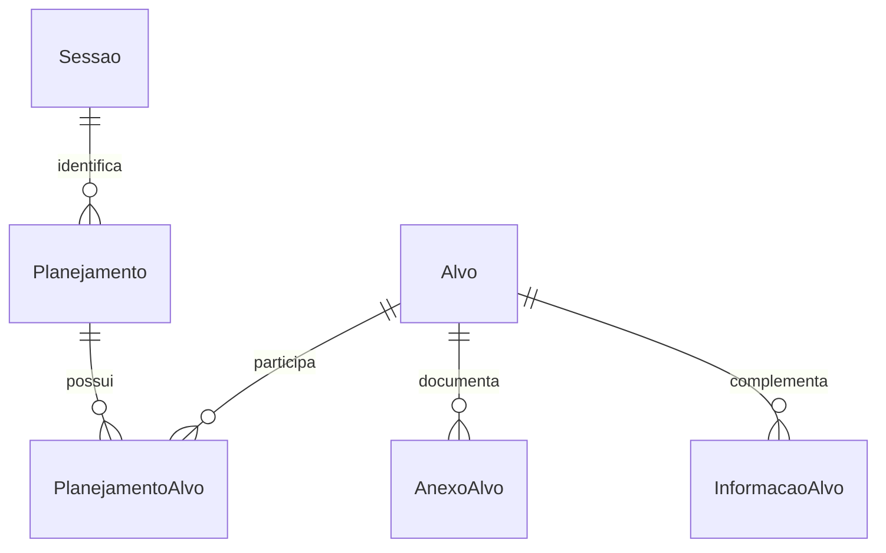

# Planejamento de Operação — arquitetura e fluxo consolidado

Consolidação das decisões de 04/11/2026. Documento para análise da arquitetura. Não representa implementação de entidades, telas, banco ou geração documental.

## 1. Objetivo e decisões consolidadas

O cadastro começa pelo planejamento operacional, destinado a um único endereço. Durante seu preenchimento são coletadas as informações de uma ou mais pessoas, denominadas alvos. Ao finalizar, o sistema apresenta uma visualização completa do planejamento, incluindo conteúdo tático e alvos.

A consulta tem o alvo como ponto de entrada. Ao localizar uma pessoa, o usuário acessa os planejamentos associados a ela, com data e endereço de cada ocasião.

A exportação para PDF é opcional. Somente quando solicitada será utilizada a biblioteca de modelos institucionais DOCX e o componente de geração documental.

Decisões centrais:

- Planejamento e Alvo possuem relação N:N, materializada por PlanejamentoAlvo.
- Cada planejamento possui um único endereço de atuação e suas coordenadas.
- Alvo representa a pessoa, reutilizável em diferentes planejamentos.
- PlanejamentoAlvo contém as chaves do planejamento e do alvo.
- Não há fluxo independente de criação de alvo sem planejamento.
- Coletar dados no formulário não significa persistir imediatamente no banco.
- SecaoID identifica a seção responsável e permite filtros, sem restringir a visualização de outras seções.
- Biblioteca de modelos e geração documental são componentes separados, implementados em etapas posteriores.

## 2. Entidades e relacionamentos

| Entidade | Responsabilidade | Campos centrais |
| --- | --- | --- |
| Planejamento | Planejamento operacional para um único endereço | ID, SecaoID, Titulo, DataPrevista, Situacao, OrdemServico, UnidadeApoio, Objetivo, endereço e coordenadas, autoria e datas |
| Alvo | Identificação da pessoa | ID, Nome, IdentificacaoProvisoria, Alcunha, CPF, RG, OrgaoEmissorRG, UFRG, DataNascimento, NomeMae, NomePai, autoria e datas |
| PlanejamentoAlvo | Associação entre planejamento e pessoa | ID, PlanejamentoID, AlvoID; proposta adicional: CodigoNoPlanejamento, ObservacoesContextuais |
| AnexoAlvo | Fotografias e documentos da pessoa | ID, AlvoID, Categoria, ReferenciaArmazenamento, NomeOriginal, TipoMime, Legenda, Fonte, DataReferencia, FotoPrincipal |
| InformacaoAlvo | Informações complementares da pessoa | ID, AlvoID, Categoria, Texto, Fonte, DataReferencia, SituacaoConfirmacao, AutorID |

As duas chaves de PlanejamentoAlvo são obrigatórias. O par (PlanejamentoID, AlvoID) deve ser único, impedindo a repetição da mesma pessoa no mesmo planejamento.

O zero nas coleções permite rascunhos em preenchimento; não autoriza um fluxo de cadastro avulso de alvo. Um novo alvo deve ser confirmado junto de pelo menos um vínculo. As regras de exclusão devem evitar alvos sem vínculo, preferindo preservar os registros históricos.

### Endereço e preservação do histórico

Campos propostos em Planejamento: Logradouro, Numero, Complemento, Bairro, Cidade, UF, CEP, EnderecoOriginal, Referencia, Latitude, Longitude e LinkMapaOrigem.

A regra anterior de copiar o endereço para um Alvo exclusivo do planejamento foi superada pelo modelo N:N. Neste desenho, o endereço histórico é obtido pelo Planejamento associado. Não manter um único endereço de planejamento em Alvo, pois ele seria ambíguo quando a pessoa participasse de vários planejamentos.

Exemplo fictício:

| Planejamento | Endereço | Alvos associados |
| --- | --- | --- |
| A | Rua X | João e Maria |
| B | Rua Y | João |

João possui um cadastro e duas associações. Sua consulta apresenta os planejamentos A e B com seus respectivos endereços. Criar B não altera o endereço de A.

Correções no planejamento devem ser auditadas. Se for necessário congelar exatamente a identificação, a foto e o conteúdo utilizado na ocasião, propõe-se versionar o planejamento ou guardar uma fotografia desses dados na associação. Esse detalhamento permanece pendente; o cadastro compartilhado de Alvo, sozinho, não preserva versões antigas de todos os seus atributos.

Não há necessidade de LocalPlanejamento para múltiplos endereços de atuação. Pontos auxiliares, como briefing e hospital, são referências do planejamento, não novos endereços de atuação.

## 3. Conteúdo essencial do planejamento

O conteúdo tem como referência os planejamentos consultados no Google Drive e o modelo institucional PADRAO_PLANEJAMENTO_SISTEMA.docx.

| Bloco | Informações previstas |
| --- | --- |
| Identificação | Título, data, ordem de serviço, unidade solicitante/de apoio, seção responsável e responsável pelo planejamento |
| Objetivo e mandados | Descrição da missão, tipos de cumprimento e números dos mandados |
| Endereço único | Endereço completo, referência, latitude, longitude e link do mapa |
| Equipe e funções | Operadores envolvidos e funções atribuídas naquele planejamento |
| Viaturas | Viaturas utilizadas e distribuição dos operadores |
| Horários | Apresentação, briefings, saída e outros marcos cadastrados |
| Rotas e localizações | Itinerários, links, distâncias/durações informadas e pontos auxiliares |
| Comunicações | Canais e meios de comunicação registrados |
| Apoio médico | Socorristas, viatura designada, motorista, hospitais, contatos e referências de localização |
| Particularidades | Observações e informações relevantes sobre o local |
| Medidas complementares | Providências, responsáveis e pendências |
| Imagens e anexos | Fotos do imóvel, mapas, croquis e documentos do planejamento |
| Alvos | Pessoas associadas, identificação, fotografias e informações contextuais |

Coleções como integrantes, horários, rotas, mandados e anexos deverão ter registros próprios vinculados ao planejamento quando forem implementadas. A nomenclatura e os campos finais serão detalhados por etapa. Não concentrar listas em campos de texto separados por vírgula.

## 4. Componentes e momentos de entrada

### Cadastro e persistência

Responsável por coletar, validar e gravar planejamento, alvos novos ou existentes e suas associações. Não depende de modelo DOCX, conversão para PDF ou biblioteca ativa.

Durante o preenchimento, os dados dos alvos ficam no modelo do formulário até a ação de salvar. O fato de já haver informações suficientes para compor Alvo não dispara uma gravação antecipada.

Proposta para a criação, em uma única transação de banco:

1. Validar os dados e identificar alvos já cadastrados, evitando duplicações por nome.
2. Inserir o Planejamento e obter sua identificação, ainda dentro da transação.
3. Inserir os novos Alvos necessários ou reutilizar os registros existentes.
4. Inserir PlanejamentoAlvo com ambas as chaves válidas e gravar os demais dados previstos nessa etapa.
5. Confirmar a transação somente se todas as operações forem concluídas.

Se ocorrer falha, reverter as gravações da transação. Um alvo existente não será recriado para cada planejamento. Uma chave estrangeira garante a validade do vínculo; o serviço de gravação deve garantir também que nenhum novo alvo seja confirmado sem associação.

Arquivos anexos exigem tratamento próprio: a transação SQL não reverte automaticamente arquivos no armazenamento. Na implementação, prever upload temporário e limpeza/compensação em caso de falha.

### Visualização geral

Após salvar/finalizar, exibir as informações do planejamento, seu endereço e todos os alvos associados. A visualização é uma tela do sistema, disponível independentemente dos componentes documentais.

### Consulta por alvo

Fluxo principal: pesquisar alvo → identificar a pessoa → listar seus planejamentos → abrir a visualização completa de um planejamento.

A pesquisa poderá usar nome, alcunha e CPF. Nome semelhante não prova identidade. A lista de planejamentos deve trazer data, identificação, seção e endereço da ocasião. Filtro por seção é uma conveniência, não uma barreira de visualização entre seções.

### Biblioteca de modelos — etapa posterior

Mantém modelos DOCX institucionais por seção, com versionamento. Cada seção pode ter várias versões e, no máximo, uma ativa. Para gerar, é necessário existir uma versão ativa válida.

Proposta de entidade ModeloPlanejamento: ID, SecaoID, Versao, Ativo, ReferenciaArquivo, AutorID e DataHoraCriacao. Uma versão publicada deve permanecer disponível para rastrear documentos já gerados. A ativação deve ser transacional e a exclusividade do modelo ativo deve ser garantida também no banco.

O modelo será selecionado automaticamente pela seção do usuário autenticado que solicita a exportação, consultada no servidor. Não aceitar uma seção enviada livremente pelo navegador como fonte dessa decisão.

### Geração documental — etapa posterior e opcional

Apenas ao escolher “Exportar PDF”:

1. Verificar o acesso ao planejamento e resolver a seção do usuário autenticado.
2. Consultar a versão ativa do modelo dessa seção.
3. Ler uma visão consistente dos dados persistidos do planejamento e seus alvos.
4. Preencher o DOCX preservando estilos, imagens, tabelas e blocos repetitivos.
5. Converter para PDF e disponibilizar o resultado.

O DOCX é o modelo/intermediário de geração; a saída solicitada nesse fluxo é PDF. Falhas na geração não desfazem o planejamento cadastrado. Ausência de modelo ativo impede somente a exportação.

Proposta de entidade DocumentoPlanejamento: ID, PlanejamentoID, ModeloPlanejamentoID, UsuarioGeradorID, DataHoraGeracao, Situacao e ReferenciaArquivo. Registrar a versão exata do modelo e a revisão ou fotografia dos dados usados, para rastreabilidade.

## 5. Seção responsável e seleção do modelo

Planejamento.SecaoID será preenchido na criação com a seção do usuário autenticado e referenciará a entidade Sessao existente. Abrir ou editar por outra seção não altera automaticamente essa identificação.

O campo serve para consultas da própria seção. Usuários de outras seções podem visualizar os planejamentos, respeitando as permissões gerais de acesso ao sistema. Regras de edição, exclusão e administração de modelos ainda serão detalhadas; acesso de leitura entre seções não implica automaticamente permissão para todas as ações.

A seção responsável pelo planejamento e a seção utilizada para escolher o modelo são conceitos distintos. Conforme o alinhamento, a seleção do modelo usa a seção do usuário que exporta, não Planejamento.SecaoID. Assim, usuários de seções distintas podem exportar o mesmo planejamento em modelos diferentes; a geração deve registrar o modelo efetivamente utilizado.

Se o usuário não tiver operador/seção associada, não inferir uma seção arbitrária. O tratamento desse caso deve ser definido antes de implementar criação e exportação.

## 6. Interface enxuta

A entrada do módulo deve oferecer “Novo planejamento” e “Consultar alvo”. A consulta principal é centrada na pessoa, em substituição à proposta anterior centrada na busca de planejamentos.

No cadastro, separar dados do Planejamento e Alvos associados, mantendo o preenchimento integrado. Não oferecer cadastro avulso de alvo nessa versão.

A visualização geral reúne as seções preenchidas. O botão de exportação será incorporado quando biblioteca e geração estiverem disponíveis. Uma eventual lista de rascunhos/planejamentos da seção é recurso auxiliar, a detalhar, sem substituir o fluxo de consulta por alvo.

## 7. Regras de dados propostas

- CPF é opcional, textual e normalizado, preservando zeros à esquerda; validar quando informado. A regra de unicidade para valores válidos e o tratamento de duplicidades legadas precisam ser definidos antes da migration.
- Nome ou identificação provisória permite iniciar a identificação de uma pessoa ainda incompleta. Não unir cadastros automaticamente por nome.
- O vínculo (PlanejamentoID, AlvoID) é único. Se houver código do alvo, sua unicidade é dentro do planejamento, não global.
- Latitude e longitude são preenchidas juntas, com limites válidos; proposta SQL decimal(10,7). Ausência é nulo. Links encurtados não equivalem a coordenadas validadas.
- Cada alvo pode possuir várias fotografias e no máximo uma principal.
- Informações específicas de uma ocasião pertencem a PlanejamentoAlvo ou a registros vinculados a ele; informações gerais da pessoa pertencem a Alvo/InformacaoAlvo.
- Anexos gerais da pessoa e imagens do planejamento têm responsabilidades distintas. Se houver anexo contextual de uma pessoa naquela ocasião, vinculá-lo à associação em detalhamento posterior.
- Novos planejamentos nunca sobrescrevem endereços de planejamentos anteriores.
- Rascunho, finalização, correção e histórico de versões precisam de regras explícitas antes de implementação.

## 8. Integração com a arquitetura atual do SVG.DOE

A aplicação existente usa ASP.NET Core MVC, serviços de aplicação/domínio, Entity Framework 6 e SimpleInjector. A proposta mantém essas camadas.

| Camada | Responsabilidade no novo módulo |
| --- | --- |
| SVG.Domain | Entidades, regras e interfaces de serviços/repositórios. Sem dependência de HTTP ou manipulação concreta de DOCX. |
| SVG.App | ViewModels, coordenação dos casos de uso de cadastro, consulta e exportação. |
| SVG.Infra | Persistência EF6, mapeamentos, migrations, armazenamento e implementações de preenchimento DOCX/conversão PDF. |
| SVG.WebApp | Controllers, telas Razor, validação de entrada e obtenção da identidade autenticada. |
| SVG.Cross | Registro dos serviços e repositórios no SimpleInjector, respeitando o escopo do contexto. |

Pontos verificados no código:

- A seção organizacional é representada por Sessao; Operador possui SessaoID.
- Usuario pode não possuir Operador associado.
- IUserContext oferece OperadorId, mas não expõe diretamente a seção. Resolver a seção no servidor pelo operador autenticado, sem criar dependência de SVG.App para SVG.WebApp.
- RepositoryBase chama SaveChanges em cada operação. O caso de uso composto precisa de método de persistência específico ou contrato transacional que mantenha todas as gravações no mesmo contexto/transação; chamadas independentes sem essa coordenação não atendem ao fluxo.
- SQLServerContext aplica limite padrão de 100 caracteres às strings. Observações, descrições, endereços e referências de arquivos exigirão mapeamentos explícitos.
- A entidade Operacao já existe. O relacionamento dela com Planejamento permanece pendente; não tratá-las como sinônimos nem introduzir cardinalidade sem definição.

Não é necessário criar novos projetos ou serviços externos para separar os componentes. Contratos e implementações dentro das camadas existentes são suficientes como ponto inicial. A biblioteca concreta de DOCX e o conversor PDF serão avaliados quando chegar a etapa documental.

## 9. Adequações futuras do modelo Word

Na análise textual do PADRAO_PLANEJAMENTO_SISTEMA.docx foram identificados marcadores para unidade, data, OS, horários, comunicações, apoio médico, responsáveis e localizações.

Antes de implementar o gerador:

- Definir bloco repetível para identificação e foto de todos os alvos.
- Definir repetição de linhas do quadro de funções.
- Definir marcadores para imagens do planejamento e suas legendas.
- Substituir valores genéricos de distância/duração por campos opcionais apropriados.
- Completar o suporte a números de mandados e conteúdos opcionais.
- Definir contrato de marcadores, validar modelos enviados e tratar marcadores desconhecidos ou sem dados.
- Tratar marcadores que o Word pode dividir em diferentes trechos de formatação, evitando substituição ingênua no XML.
- Verificar visualmente a preservação da formatação e o PDF final com múltiplos alvos, tabelas extensas e imagens.

O arquivo Word permanece inalterado. Esta análise de conteúdo não certifica sua renderização.

## 10. Sequência de implementação proposta

1. Detalhar e implementar o núcleo Planejamento, Alvo e PlanejamentoAlvo, com cadastro integrado e gravação transacional.
2. Implementar a visualização geral e a consulta por alvo, acrescentando anexos e demais blocos conforme o escopo de cada entrega.
3. Implementar a biblioteca de modelos por seção, com versões e ativação.
4. Implementar geração DOCX e conversão para PDF, acionadas somente por solicitação de exportação.

Cada componente entra no momento definido pelo usuário. Planejamento, alvos, consulta e visualização não devem depender de modelos cadastrados nem da disponibilidade do conversor.

## 11. Decisões ainda pendentes

- Relacionamento entre Operacao e Planejamento.
- Situações do planejamento, finalização, correções e congelamento de dados históricos.
- Política de identificação/unificação de pessoas e CPF duplicado.
- Permissões de edição, exclusão e administração de modelos.
- Tratamento de usuários sem operador/seção.
- Campos exatos dos blocos repetitivos e detalhes contextuais da associação.
- Armazenamento de anexos, tecnologia de preenchimento DOCX e conversão PDF.

## 12. Fontes e limites

Consolidação baseada no alinhamento desta conversa, no texto de orientação fornecido, no modelo Word local e na leitura da arquitetura atual. O levantamento textual dos documentos do Drive identificou padrões, repetições e divergências entre títulos e conteúdo; imagens e vídeos não foram integralmente interpretados. Qualquer futura importação deverá preservar a origem e permitir revisão.

Nesta etapa foi atualizado somente este documento Markdown. Nenhuma implementação, migration, alteração do Word ou operação no banco foi executada.

## Ajustes consolidados na implementação — 05/11/2026

O núcleo segue a relação N:N descrita acima. Os tipos estruturados usam prefixo `X` (por exemplo, `XPlanejamentoEntrada`) e as entidades usam `DataHoraCriacao`.

Anexos de planejamento e alvo aceitam fotos e vídeos. O banco guarda somente caminhos relativos e metadados, sem conteúdo binário. A organização é `Imagens/Planejamento/{PlanejamentoID}/{hash}.ext` e `Imagens/Alvo/{AlvoID}/{hash}.ext`, com acesso autenticado e armazenamento substituível para manter as mesmas chaves no Azure. Arquivos enviados recebem identificadores únicos por hash.

A configuração de cultura foi generalizada para todos os controllers MVC, separando conversão dos formulários e apresentação. Detalhes, limites, compensação de arquivos e verificações estão em [PlanejamentoOperacao-Implementacao.md](PlanejamentoOperacao-Implementacao.md). As migrations permanecem apenas preparadas para revisão.
